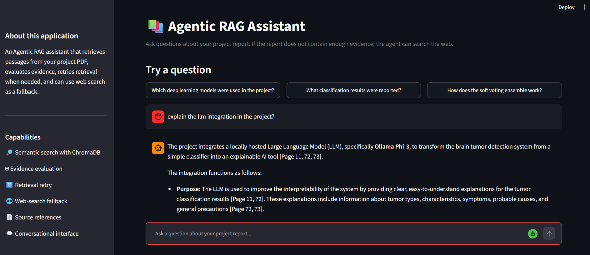

# 🤖 Agentic RAG Assistant
### Intelligent Document Question Answering with LangGraph, Gemini, ChromaDB and Web Search

An intelligent **Agentic Retrieval-Augmented Generation (RAG) application** that combines document retrieval, evidence evaluation, conditional retrieval retries, web search and Large Language Models to generate context-grounded answers.

Unlike a basic RAG pipeline that simply retrieves document chunks and sends them to an LLM, this application uses an agentic workflow to make decisions based on the quality and availability of retrieved evidence.

The application is built using **Python, LangGraph, Google Gemini, ChromaDB, LangChain and Streamlit**.

---

## 📌 Table of Contents

1. Overview
2. Problem Statement
3. Key Features
4. System Architecture
5. Agentic Workflow
6. Technology Stack
7. Project Structure
8. Retrieval and Answer Generation
9. Installation and Setup
10. Running the Application
11. Example Use Cases
12. Current Limitations
13. Future Enhancements
14. Author

---

## 1. Overview

Traditional document question-answering systems often rely on a straightforward retrieval pipeline. They retrieve a fixed number of text chunks from a document and pass them to an LLM to generate an answer.

However, this approach has limitations:

- Retrieved passages may not contain sufficient evidence.
- Relevant information may not appear in the initially retrieved chunks.
- The source document may not contain the answer.
- The LLM may generate unsupported information when context is insufficient.

This project addresses these challenges through an **agentic RAG architecture**.

The system retrieves relevant passages from an indexed PDF, evaluates whether the retrieved information is adequate, retries retrieval when necessary, and uses web search as an alternative information source when local evidence is insufficient.

The final response includes relevant source references to improve transparency and traceability.

---

## 2. Problem Statement

A conventional RAG system generally follows:

`User Query → Retrieval → LLM → Answer`

This approach does not necessarily determine whether the retrieved evidence actually answers the user's question.

For example, consider a user asking:

"What is the population of Tokyo?"

If the indexed PDF is a brain tumor classification project report, it will not contain information about Tokyo's population.

A basic RAG system may return irrelevant passages or generate an unsupported answer.

The proposed Agentic RAG system introduces additional decision-making stages:

- Retrieve relevant document passages.
- Evaluate the retrieved evidence.
- Retry retrieval with an expanded retrieval configuration.
- Search the web if local evidence remains insufficient.
- Generate an answer using the available evidence.
- Return supporting source references.

---

## 3. Key Features

### 🔎 Semantic Document Retrieval

- Uses vector embeddings to represent document chunks.
- Stores embeddings in ChromaDB.
- Retrieves semantically relevant passages based on the user's query.
- Supports retrieval from an indexed PDF document.

### 🤖 Agentic Workflow Orchestration

- Uses LangGraph to coordinate the retrieval and answer-generation workflow.
- Maintains state throughout the execution.
- Uses conditional routing to determine the next operation.
- Separates retrieval, evaluation, retry and answer-generation stages.

### 🧠 Evidence Evaluation

- Evaluates whether retrieved document passages contain sufficient information.
- Determines whether retrieval should be retried or the workflow should use another information source.

### 🔄 Adaptive Retrieval Retry

- Starts with an initial retrieval of four passages.
- Retries retrieval with eight passages when evidence is insufficient.
- Avoids immediately switching to external search after the first unsuccessful retrieval.

### 🌐 Web Search Fallback

- Integrates DuckDuckGo search through DDGS.
- Retrieves external search-result titles, snippets and URLs.
- Uses web evidence when local document evidence is insufficient.
- Provides web source references in generated answers.

### ✨ Gemini-Powered Answer Generation

- Uses Google Gemini for natural-language answer generation.
- Combines relevant context with the user's question.
- Generates answers grounded in available document or web evidence.

### 📚 Source Attribution

- Displays document source names and page references.
- Provides web URLs for externally retrieved information.
- Helps users identify where supporting information originated.

### 💻 Interactive Streamlit Application

- Provides a conversational interface.
- Supports user questions and suggested queries.
- Displays generated answers and source references.
- Maintains conversation history during the application session.

---

## 4. System Architecture

The application consists of interconnected components responsible for document ingestion, vector storage, agent orchestration, external search and answer generation.

### High-Level Architecture

```text
                 USER
                   |
                   v
             STREAMLIT UI
                   |
                   v
             USER QUESTION
                   |
                   v
            LANGGRAPH AGENT
                   |
                   v
          DOCUMENT RETRIEVAL
                   |
                   v
             CHROMADB
                   |
                   v
          EVIDENCE EVALUATION
                   |
             +-----+-----+
             |           |
             v           v
         SUFFICIENT  INSUFFICIENT
             |           |
             v           v
       LOCAL ANSWER   RETRY RETRIEVAL
                         |
                         v
                   RE-EVALUATION
                         |
                         v
                    WEB SEARCH
                         |
                         v
                  EXTERNAL RESULTS
                         |
                         v
                   GEMINI LLM
                         |
                         v
                 FINAL RESPONSE
                         |
                         v
                 ANSWER + SOURCES
```

### Component Responsibilities

| Component | Responsibility |
|---|---|
| Streamlit | User interface and conversation management |
| LangGraph | Agent workflow and conditional routing |
| ChromaDB | Vector storage and similarity retrieval |
| LangChain | Document and LLM integration |
| Gemini | Embeddings and answer generation |
| DDGS | External web search |
| Python | Application logic and integration |

---

## 5. Agentic Workflow

The agent follows a multi-stage workflow.

### Stage 1: User Query

The user enters a natural-language question through the Streamlit interface.

The question is passed to the LangGraph agent.

### Stage 2: Initial Document Retrieval

The retrieval component searches the existing ChromaDB collection.

- Initial retrieval size: 4 passages.
- Retrieval method: Semantic search using vector embeddings.

The retrieved passages are passed to the evidence-evaluation stage.

### Stage 3: Evidence Evaluation

The agent evaluates whether the retrieved passages contain sufficient information to answer the question.

Two possible outcomes exist:

**Sufficient evidence**

The retrieved passages are passed to the answer-generation component.

**Insufficient evidence**

The agent proceeds to retrieval retry.

### Stage 4: Conditional Retrieval Retry

The agent retries retrieval with an expanded retrieval configuration.

- Initial retrieval: 4 passages.
- Retry retrieval: 8 passages.

This provides another opportunity to locate relevant information within the indexed document.

### Stage 5: Web Search Fallback

If local evidence remains insufficient, the agent initiates external web search.

The DDGS integration retrieves:

- Search-result titles.
- Relevant text snippets.
- Source URLs.

These results are passed to the answer-generation component.

### Stage 6: Answer Generation

Google Gemini generates a natural-language response using the available context.

The answer-generation component distinguishes between document evidence and web evidence and provides source references.

### Stage 7: Final Response

The application displays:

- Generated answer.
- Supporting PDF page references, when applicable.
- External web sources, when applicable.

---

## 6. Technology Stack

| Technology | Application |
|---|---|
| Python 3.11 | Core development |
| LangGraph | Agentic workflow orchestration |
| LangChain | LLM and document integration |
| Google Gemini API | Embeddings and answer generation |
| ChromaDB | Vector database |
| Streamlit | Interactive web interface |
| DDGS | Web search integration |
| Python-dotenv | Environment variable management |

---

## 7. Project Structure

```text
Agentic-RAG-Assistant/
│
├── app.py
│
├── src/
│   ├── agent_graph.py
│   ├── answer_generator.py
│   ├── config.py
│   ├── evaluate_agent.py
│   ├── index_documents.py
│   ├── ingestion.py
│   ├── inspect_document.py
│   ├── inspect_images.py
│   ├── inspect_tables.py
│   ├── vector_store.py
│   ├── web_search.py
│   │
│   └── test_*.py
│
├── requirements.txt
├── .env.example
├── .gitignore
└── README.md
```

*Note: Local PDFs, generated vector databases, virtual environments and API credentials are excluded from the public repository.*

---

## 8. Retrieval and Answer Generation

### Document Processing

The ingestion component extracts text from the project PDF and prepares it for retrieval.

The extracted text is divided into smaller chunks suitable for embedding and semantic search.

### Vector Embeddings

The embedding model converts document chunks into numerical vector representations.

These vectors are stored in ChromaDB for efficient retrieval.

### Semantic Retrieval

When a user asks a question, the system converts the query into an embedding and retrieves semantically related chunks.

### Context-Grounded Generation

The retrieved information is passed to Gemini to generate a response.

When the local document does not contain sufficient information, the agent can use external web-search results as additional evidence.

---

## 9. Installation and Setup

### Prerequisites

- Python 3.11 or later.
- Git.
- Google Gemini API key.
- VS Code or another Python IDE.

### Step 1: Clone the Repository

```bash
git clone https://github.com/Tejas-120/Agentic-RAG-Assistant.git
```

```bash
cd Agentic-RAG-Assistant
```

### Step 2: Create a Virtual Environment

```bash
python -m venv .venv
```

Activate on Windows:

```powershell
.venv\Scripts\activate
```

### Step 3: Install Dependencies

```bash
pip install -r requirements.txt
```

### Step 4: Configure Environment Variables

Create a `.env` file in the project root.

```env
GEMINI_API_KEY=your_gemini_api_key
```

Do not upload the `.env` file to GitHub.

### Step 5: Add and Index Your PDF

Place the PDF you are authorized to process in the appropriate local documents directory.

Follow the document ingestion and indexing workflow provided in the source code.

The application requires an indexed document collection to perform retrieval.

### Step 6: Run the Application

```bash
streamlit run app.py
```

Open the application:

http://localhost:8501

---

## 10. Example Use Cases

### Use Case 1: Document-Based Question Answering

**Question:** Which deep learning architectures were used in the project?

Expected workflow:

1. Retrieve relevant passages from the indexed PDF.
2. Evaluate retrieved evidence.
3. Generate a response using Gemini.
4. Display supporting page references.

### Use Case 2: Insufficient Document Evidence

**Question:** What is the population of Tokyo?

Expected workflow:

1. Search the indexed PDF.
2. Evaluate the retrieved passages.
3. Retry retrieval with a larger number of passages.
4. Search the web if local evidence remains insufficient.
5. Generate a response using available web evidence.
6. Display external source URLs.

---

## 11. Current Limitations

- The current application is configured around an indexed PDF collection.
- Multiple independent PDF uploads and document selection are not yet implemented.
- Web-search results depend on external search availability.
- Gemini API usage is subject to model availability, quotas and rate limits.
- Answer quality depends on the relevance and reliability of retrieved evidence.

---

## 12. Future Enhancements

The following features are planned for subsequent development:

- **Multi-PDF Upload:** Allow users to upload and query multiple PDF documents.
- **Document-Level Isolation:** Maintain separate retrieval contexts for different documents.
- **Improved Evidence Grading:** Implement more robust semantic relevance and answerability evaluation.
- **Conversation Memory:** Maintain useful context across multiple questions.
- **Advanced Retrieval:** Explore hybrid search, reranking and query transformation.
- **Evaluation Framework:** Measure retrieval precision, recall, faithfulness and answer relevance.
- **Cloud Deployment:** Deploy the application for public access.
- **Improved User Experience:** Add document management, chat history and retrieval transparency.

---

## 13. Author

**Tejas Yarlagadda**

Electronics and Communication Engineering Graduate

GitHub: [Tejas-120](https://github.com/Tejas-120)

Project Repository: [Agentic-RAG-Assistant](https://github.com/Tejas-120/Agentic-RAG-Assistant)

---

## Acknowledgements

Built using the open-source Python ecosystem and Google Gemini services.
## Application Preview of the project



